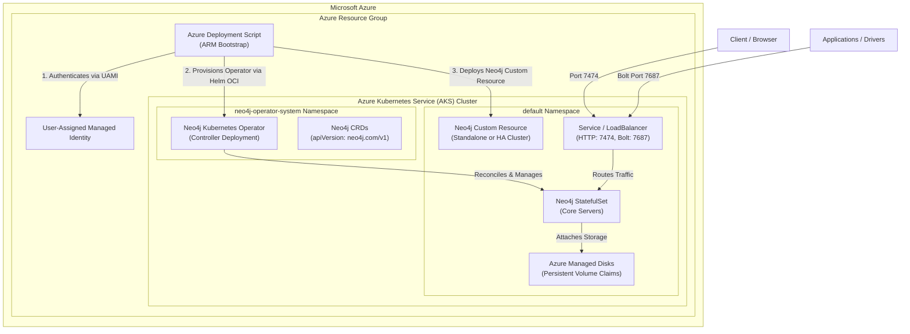

# Neo4j Kubernetes Operator on Azure Kubernetes Service (AKS)

[](https://azuremarketplace.microsoft.com/)
[](https://kubernetes.io/)
[](https://neo4j.com/)
[](LICENSE)

This repository contains Azure Resource Manager (ARM) templates, Azure Marketplace UI definitions, and automation scripts to deploy the official [Neo4j Kubernetes Operator](https://github.com/neo4j-partners/neo4j-kubernetes-operator) on **Azure Kubernetes Service (AKS)**. 

It is designed to power the official **Azure Marketplace Solution Template** offer while enabling command-line and automated deployments via the Azure CLI.

---

## Architecture Overview



---

## Features

- **Automated AKS Cluster Provisioning**: Creates an enterprise-grade AKS cluster with system node pools, Azure CNI or Kubenet networking, and Azure Managed Disk CSI driver integration.
- **Automated Operator Installation**: Uses Azure Deployment Scripts (`Microsoft.Resources/deploymentScripts`) to fetch and install the official Neo4j Kubernetes Operator Helm chart directly from the OCI registry (`ghcr.io/neo4j-partners/charts/neo4j-operator`).
- **Flexible Topologies**:
  - **Standalone**: Single-instance deployment ideal for development, testing, and departmental workloads.
  - **High-Availability Cluster**: Multi-core autonomous Raft clustering for production enterprise deployments.
- **Dual Edition Support**:
  - **Enterprise Edition**: High-availability clustering, enterprise security, and hot backups.
  - **Community Edition**: Fully open-source graph database engine.
- **Marketplace Ready**: Includes full `createUiDefinition.json` for a native Azure Portal wizard experience and packaging tools for Microsoft Partner Center.

---

## Repository Structure

```
├── mainTemplate.json             # Core ARM template defining AKS, Managed Identity, and Deployment Script
├── createUiDefinition.json       # Azure Portal UI wizard definition for Marketplace
├── azuredeploy.json              # Standard entry point mirroring mainTemplate.json
├── azuredeploy.parameters.json   # Sample deployment parameters for testing
├── deploy.sh                     # Automated CLI deployment script
├── dist/                         # Distribution build artifacts (generated)
├── manifests/                    # Kubernetes manifests and Custom Resource examples
│   ├── neo4j-standalone.yaml     # Standalone Neo4j instance CR
│   ├── neo4j-cluster.yaml        # 3-node HA Neo4j Cluster CR
│   └── neo4j-community.yaml      # Community Edition CR
├── marketplace/                  # Marketplace publisher documentation
│   ├── PARTNER_CENTER_GUIDE.md   # Step-by-step Partner Center publishing guide
│   └── OFFER_CHECKLIST.md        # Technical and marketing submission checklist
└── scripts/                      # Helper and bootstrapping scripts
    ├── install-neo4j-operator.sh # Operator & CR installation script
    ├── package.sh                # Builds Partner Center submission .zip package
    └── verify.sh                 # Local template and schema validator
```

---

## Quick Start (Azure CLI)

### 1. Prerequisites
- [Azure CLI](https://learn.microsoft.com/en-us/cli/azure/install-azure-cli) (`az`) version 2.50.0 or higher
- [jq](https://jqlang.github.io/jq/) command-line JSON processor
- Authenticated Azure session (`az login`)

### 2. Deploy Using `deploy.sh`

Clone this repository and run the deployment script:

```bash
git clone https://github.com/neo4j-partners/azure-resource-manager-neo4j-container.git
cd azure-resource-manager-neo4j-container

# Run interactive deployment
./deploy.sh my-neo4j-rg
```

You can also pass all parameters via command-line flags:

```bash
./deploy.sh \
  --resource-group neo4j-aks-rg \
  --location eastus \
  --cluster-name neo4j-aks-prod \
  --edition enterprise \
  --topology Cluster \
  --password "YourStrongPassword123!" \
  --yes
```

Upon completion, `deploy.sh` outputs the connection endpoints and credentials:

```
============================================================
 Deployment Complete!
============================================================
Operator Status:      Success
Neo4j HTTP (Browser): http://20.120.45.18:7474
Neo4j Bolt:           bolt://20.120.45.18:7687

Connect to AKS with kubectl:
  az aks get-credentials --resource-group neo4j-aks-rg --name neo4j-aks-prod --overwrite-existing
============================================================
```

---

## Deploy via Azure Portal (Deploy to Azure)

Click the button below to deploy this template directly into your Azure subscription:

<a href="https://portal.azure.com/#create/Microsoft.Template/uri/https%3A%2F%2Fraw.githubusercontent.com%2Fneo4j-partners%2Fazure-resource-manager-neo4j-container%2Fmain%2FmainTemplate.json" target="_blank">
  
</a>

---

## Publishing to Azure Marketplace

This repository is built to be uploaded as a **Solution Template** in Microsoft Partner Center.

### Step 1: Validate Templates
Run local syntax and schema verification:
```bash
./scripts/verify.sh
```

### Step 2: Build the Marketplace Package
Generate the submission zip file:
```bash
./scripts/package.sh
```
This produces `dist/neo4j-kubernetes-operator-marketplace.zip`.

### Step 3: Upload to Partner Center
Follow the step-by-step instructions in [marketplace/PARTNER_CENTER_GUIDE.md](marketplace/PARTNER_CENTER_GUIDE.md) to register the offer, upload the technical package, configure preview testing, and submit for certification.

---

## Template Parameters

| Parameter | Type | Default | Description |
| :--- | :--- | :--- | :--- |
| `clusterName` | `string` | *(Required)* | Name of the Azure Kubernetes Service (AKS) cluster. |
| `location` | `string` | `[resourceGroup().location]` | Target Azure region. |
| `kubernetesVersion` | `string` | `1.30` | Kubernetes control plane and node version. |
| `nodeVmSize` | `string` | `Standard_D4s_v5` | Azure VM SKU for AKS worker nodes. |
| `nodeCount` | `int` | `3` | Worker node count (1 to 50). |
| `osDiskSizeGB` | `int` | `128` | OS disk size in GB per node. |
| `operatorVersion` | `string` | `1.0.0` | Release version of the Neo4j Operator. |
| `operatorNamespace` | `string` | `neo4j-operator-system` | Kubernetes namespace for the operator controller. |
| `deployDatabaseInstance`| `bool` | `true` | Automatically provisions an initial Neo4j instance. |
| `databaseInstanceName` | `string` | `neo4j-instance` | Metadata name of the Neo4j Custom Resource. |
| `neo4jEdition` | `string` | `enterprise` | Database edition (`enterprise` or `community`). |
| `acceptLicense` | `bool` | `true` | Acknowledge Neo4j Enterprise Edition license. |
| `neo4jVersion` | `string` | `5.26.0` | Neo4j Server version. |
| `topologyMode` | `string` | `Standalone` | `Standalone` or `Cluster`. |
| `clusterCoreCount` | `int` | `3` | Number of core cluster members (3 to 9). |
| `storageSize` | `string` | `20Gi` | Data volume size (e.g., `20Gi`, `100Gi`). |
| `neo4jPassword` | `securestring`| `""` | Initial password (empty generates random secret). |
| `serviceType` | `string` | `LoadBalancer` | `LoadBalancer` (Public IP) or `ClusterIP` (Internal).|

---

## Post-Deployment Operations

### 1. Connect to the AKS Cluster
```bash
az aks get-credentials --resource-group <RESOURCE_GROUP> --name <CLUSTER_NAME>
```

### 2. Inspect Operator and Pod Status
```bash
# Check operator pods
kubectl get pods -n neo4j-operator-system

# Check Neo4j database pods
kubectl get pods -l app.kubernetes.io/name=neo4j
```

### 3. Manage Neo4j Custom Resources
```bash
# List all Neo4j instances
kubectl get neo4j

# View detailed status and endpoints
kubectl describe neo4j neo4j-instance
```

### 4. Retrieve Database Password (if generated)
If an explicit password was not supplied during deployment, retrieve the operator-generated password:
```bash
kubectl get secret neo4j-instance-auth -o jsonpath='{.data.NEO4J_AUTH}' | base64 --decode
```

### 5. Access Neo4j Browser
Open `http://<LOAD_BALANCER_IP>:7474` in your browser. Enter username `neo4j` and your configured password.

---

## Clean Up

To tear down the AKS cluster, operator, database, and all associated Azure cloud resources:

```bash
az group delete --name <RESOURCE_GROUP> --yes --no-wait
```

---

## References

- [Neo4j Kubernetes Operator Repository](https://github.com/neo4j-partners/neo4j-kubernetes-operator)
- [Neo4j ARM Templates Repository](https://github.com/neo4j-partners/azure-resource-manager-neo4j)
- [Neo4j Operations Manual](https://neo4j.com/docs/operations-manual/current/)
- [Microsoft Partner Center Documentation](https://learn.microsoft.com/en-us/azure/marketplace/partner-center-portal/create-new-azure-apps-offer)

---

## License

Licensed under the Apache License, Version 2.0. See [LICENSE](LICENSE) for details.
